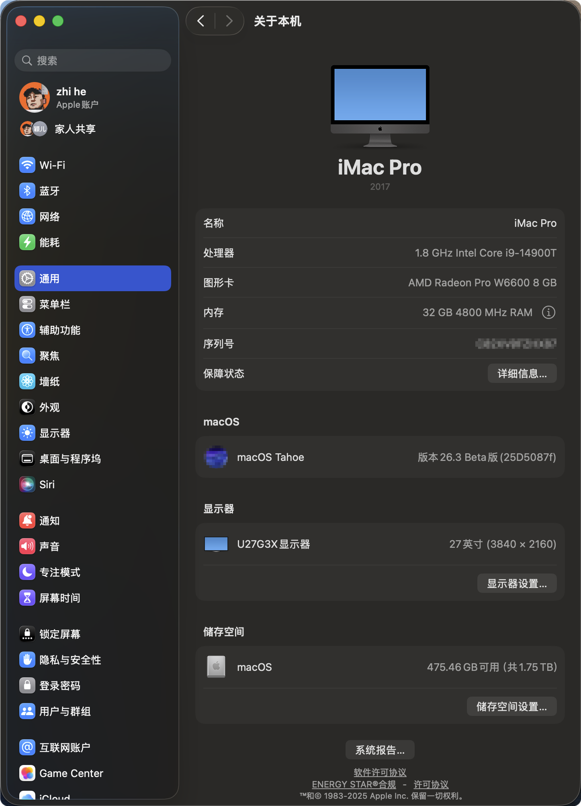
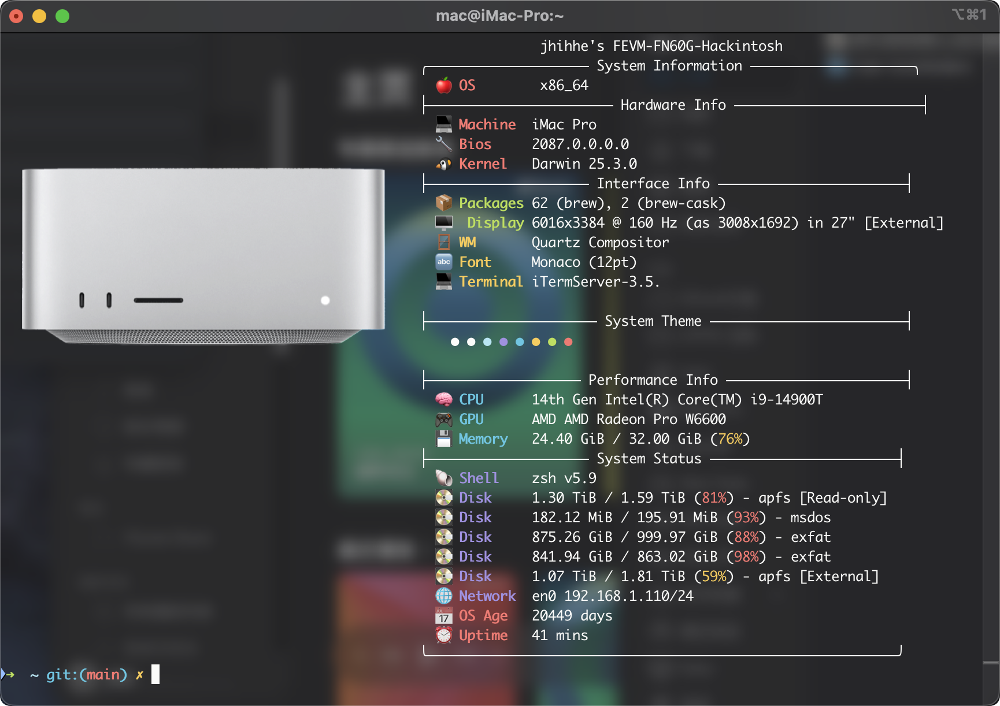

<!-- readme-visuals:header:start -->

  
  
  

<!-- readme-visuals:header:end -->

      
      
  
      

<h1 align="center">FEVM-FN60G Hackintosh EFI for OpenCore</h1>  

  <a href="https://github.com/jhihhe/FEVM-FN60G-Hackintosh/blob/main/README.md">中文</a>｜    
  <a href="https://github.com/jhihhe/FEVM-FN60G-Hackintosh/blob/main/README-EN.md">English</a>    

---

<!-- readme-visuals:overview:start -->

## At a glance

<table>
<tr>
<td width="33%"><strong>Machine configuration</strong>  OpenCore configuration for FEVM-FN60G.</td>
<td width="33%"><strong>Hardware notes</strong>  CPU, graphics, networking and USB records.</td>
<td width="33%"><strong>Downloads and checks</strong>  Release links, setup notes and recorded screenshots.</td>
</tr>
</table>

### Workflow overview

<!-- readme-visuals:overview:end -->

## 🚀 Quick Start
**Latest Stable EFI Download** →  

> **Important Notice**  
> Before use, please generate and replace the following unique identifiers:
> - Board Serial Number  
> - Serial Number  
> - SmUUID  
>
> Configuration paths:
> - `PlatformInfo → Generic`
> - `NVRAM → RtVariables → MLB & ROM`

---

## 📜 Changelog
**Core Component Updates**  
  

- ✅ Official support for macOS Tahoe 26.3
- ✅ Stable Ethernet / Wi-Fi / Audio drivers
- ✅ All core kexts updated with optimized load order for 26.3
- ✅ ACPI and boot arguments fine-tuned for the new macOS release
- ✅ Improved sleep, wake, and network wake reliability

---

## 📌 Project Overview
This project provides a **custom OpenCore EFI solution** specifically designed for  
**FEVM-FN60G (Intel 13th / 14th Gen + AMD RX 6600M)**,  
targeting **macOS Tahoe 26.3** with a strong focus on stability, full hardware acceleration, and daily usability.

### Key Features
- Native-like macOS Tahoe 26.3 experience  
- CPU power management and frequency scaling  
  *(iMacPro1,1 SMBIOS for balanced performance and stability)*  
- Full AMD dGPU acceleration with HiDPI and hardware video decoding  
- Fully functional wired / wireless networking and Bluetooth Continuity  
- Complete audio support with proper volume control  
- Seamless multi-boot coexistence with Windows and Linux  

---

## 📥 Download & Updates
- **Latest Release**: https://github.com/jhihhe/FEVM-FN60G-Hackintosh/releases  
- **Update Highlights**:
  - ✅ OpenCore 1.0.7 MOD core update
  - ✅ All kexts synced to the latest stable versions
  - ✅ ACPI and boot argument adjustments for macOS Tahoe 26.3
  - ✅ Enhanced network and audio driver stability
  - ✅ Continuous optimization of USB mapping and power management

---

## ⚙️ Hardware Configuration
| Component | Model | Notes |
|----------|------|------|
| **CPU** | Intel® Core™ i5-13600T | Supports 12th–14th Gen CPUs |
| **GPU** | AMD Radeon RX 6600M | HDMI / DP, H.264 / HEVC hardware decoding |
| **Storage** | NVMe SSD | TRIM supported |
| **Memory** | DDR5 5600MHz | Mainstream DDR5 compatibility |
| **Ethernet** | Realtek RTL8125B | Stable Gigabit Ethernet |
| **Wi-Fi / BT** | BCM94352Z | Full Wi-Fi and Bluetooth support |

---

## 📸 Functional Validation

| Module | Status | Description |
|------|------|------|
| CPU Power Management | ✅ | Proper frequency scaling |
| GPU Acceleration | ✅ | Hardware decoding & display output |
| USB | ✅ | Fully customized port mapping |
| Sleep / Wake | ✅ | Stable sleep and wake |
| Ethernet | ✅ | RTL8125B operational |
| Wireless | ✅ | Wi-Fi / Bluetooth / Continuity |
| Audio | ✅ | Full audio support with volume control |

---

## 📝 Advanced Configuration
- `ScanPolicy=0` enables multi-OS boot scanning  
- `-v` can be enabled for verbose debugging  

---

## 🙏 Acknowledgements
- OpenCore Legacy Patcher — Broadcom wireless support  
  https://github.com/dortania/OpenCore-Legacy-Patcher
- daliansky/FEVM-FN60G-Hackintosh — EFI reference  
  https://github.com/daliansky/FEVM-FN60G-Hackintosh
- Xmingbai/FEVM-FN60G-Hackintosh — Compatibility solutions  
  https://github.com/Xmingbai/FEVM-FN60G-Hackintosh
- Daliansky Blog — Installation guides and troubleshooting  
  https://blog.daliansky.net/
