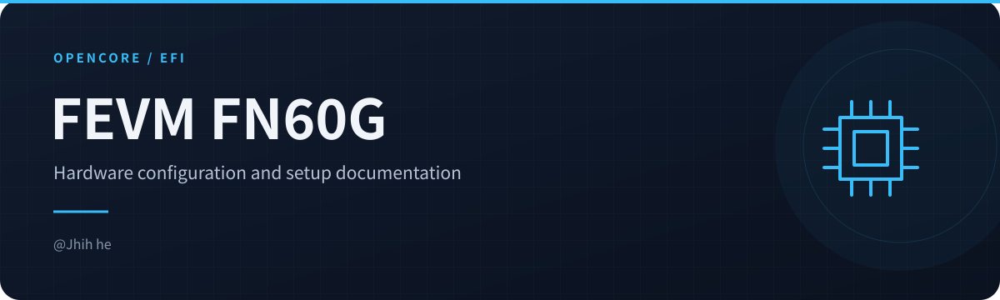
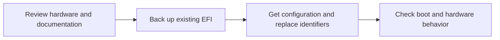

<!-- readme-visuals:header:start -->

  
  
  

<!-- readme-visuals:header:end -->

  
  
  
  

<h1 align="center">FEVM-FN60G Hackintosh EFI for OpenCore</h1>

  <a href="https://github.com/jhihhe/FEVM-FN60G-Hackintosh/blob/main/README.md">中文</a>｜
  <a href="https://github.com/jhihhe/FEVM-FN60G-Hackintosh/blob/main/README-EN.md">English</a>

[中文说明 →](README.md)

> **No OCLP root patching required for audio or Wi-Fi.** SimpleHDA + AppleALC handle audio and SimpleBCM handles Wi-Fi directly from EFI. This daily setup does not require installing OCLP or patching the system volume for these devices. If old OCLP patches are already installed, follow the migration instructions below.

---

<!-- readme-visuals:overview:start -->

## At a glance

<table>
<tr>
<td width="33%"><strong>Machine configuration</strong>  OpenCore configuration for FEVM-FN60G.</td>
<td width="33%"><strong>Hardware notes</strong>  CPU, graphics, networking and USB records.</td>
<td width="33%"><strong>Downloads and checks</strong>  Release links, setup notes and validation status.</td>
</tr>
</table>

### Workflow overview

<!-- readme-visuals:overview:end -->

## 🚀 Quick Start
**Latest Stable EFI Download** →

> **Important Notice**
> Generate your own `MLB`, `SystemSerialNumber`, `SystemUUID` and `ROM` in `EFI/OC/config.plist → PlatformInfo → Generic`. The public values are cleared. Keep MacPro7,1 and do not copy someone else's identity.
>
> Back up your EFI and test from a bootable USB first. Preserve your own Windows `Microsoft` directory.

---

## 📜 Changelog
**Core Component Updates**

- One daily configuration: RX 6600M handles output; UHD 770 / WhateverXe experiments are removed.
- SimpleBCM 1.2.0 handles Wi-Fi; SimpleHDA 1.0.1 and AppleALC handle audio, replacing the corresponding OCLP root patches.
- The owner confirmed a full daily-EFI regression on macOS 26.7.1 (25G313).
- Public packaging clears identifiers, removes old screenshots and logs, the failing PcmMsrDriver helper, old CPU-name overrides and stale OCLP variables.
- The release uses OpenCore 1.0.9 MOD (BTWISE), retaining the existing working bootloader.

See [changes](CHANGELOG.md) and [component versions](docs/COMPONENTS.md).

---

## 📌 Project Overview
This project provides a daily **OpenCore EFI configuration** for **FEVM-FN60G (i5-13600T + AMD RX 6600M)**, tested on **macOS Tahoe 26.7.1**.

### Key Features
- Existing CPU power management with MacPro7,1 SMBIOS.
- RX 6600M output and acceleration with WhateverGreen and the working GPU properties.
- SimpleBCM Wi-Fi and LucyRTL8125Ethernet wired networking.
- SimpleHDA with AppleALC audio, using `alcid=98`.
- Existing multi-OS scanning and machine-specific USB mapping; other hardware revisions require their own checks.

---

## 📥 Download & Updates
- **Latest Release**: https://github.com/jhihhe/FEVM-FN60G-Hackintosh/releases
- **Update Highlights**:
  - Audio and Wi-Fi load from EFI, with one config.plist.
  - Retained daily RX 6600M profile; removed iGPU experiments.
  - Added sanitized identifiers, migration and rollback instructions. Historical commits, tags and releases remain available.

---

## ⚙️ Hardware Configuration
| Component | Model | Notes |
|----------|------|------|
| **CPU** | Intel® Core™ i5-13600T | Tested CPU; other models require validation |
| **GPU** | AMD Radeon RX 6600M | Display and acceleration; W6600 is an injected name |
| **Storage** | NVMe SSD | TRIM supported |
| **Memory** | DDR5 5600MHz | Original hardware record; check installed modules |
| **Ethernet** | Realtek RTL8125B | LucyRTL8125Ethernet |
| **Wi-Fi / BT** | Broadcom (14e4:43a0) | SimpleBCM Wi-Fi |

---

## 📸 Functional Validation

The owner confirmed a full daily-EFI regression on November 10, 2026. The original categories are retained below; individual test logs were not supplied.

| Module | Status | Description |
|------|------|------|
| CPU Power Management | Daily regression passed | Existing configuration |
| GPU Acceleration | Daily regression passed | RX 6600M output; Metal checked |
| USB | Daily regression passed | Machine-specific mapping |
| Sleep / Wake | Daily regression passed | Based on the owner's overall report |
| Ethernet | Daily regression passed | RTL8125 |
| Wireless | Daily regression passed | SimpleBCM; no separate Continuity test record |
| Audio | Daily regression passed | SimpleHDA + AppleALC |

The sanitized package passed static checks but has not been boot-tested again after packaging cleanup. Old screenshots are omitted for privacy. See [validation scope](docs/PRIVACY.md).

---

## 📝 Advanced Configuration
- `ScanPolicy=0` enables multi-OS scanning.
- Enable `-v` for debugging if needed. Graphics retain `agdpmod=pikera -wegnoigpu`.
- Existing SIP settings are retained, not hardened in this release.
- Run `python3 tools/verify_efi.py` for the public template, or add `--personalized` after filling identifiers. This checks structure, not Apple service eligibility.

### Migration and rollback

This setup loads audio and Wi-Fi support from EFI. If old OCLP Wi-Fi / AppleHDA root patches are still installed, back up the system and inspect OCLP's actual patch state before reverting them. OCLP may revert the whole patch set: plan recovery for any other required patches first. Keep your previous OCLP and an offline networking recovery option. Already migrated systems do not need another revert.

Audio uses `alcid=98`. Graphics retain WhateverGreen and `agdpmod=pikera -wegnoigpu`. No WhateverXe or Intel TGL system drivers are supplied. Existing SIP settings are preserved rather than hardened for this release.

For rollback, boot the recovery USB and restore your own EFI backup. Reinstall the previous root patches if the old configuration requires them; restoring EFI alone does not restore the system volume. Any previously installed WhateverXe system drivers need the original installer's uninstall procedure.

---

## 🙏 Acknowledgements
- [SimpleBCM](https://github.com/laobamac/SimpleBCM) / [SimpleHDA](https://github.com/laobamac/SimpleHDA) — current Wi-Fi and audio support
- OpenCore Legacy Patcher — Broadcom wireless support
  https://github.com/dortania/OpenCore-Legacy-Patcher
- daliansky/FEVM-FN60G-Hackintosh — EFI reference
  https://github.com/daliansky/FEVM-FN60G-Hackintosh
- Xmingbai/FEVM-FN60G-Hackintosh — Compatibility solutions
  https://github.com/Xmingbai/FEVM-FN60G-Hackintosh
- Daliansky Blog — Installation guides and troubleshooting
  https://blog.daliansky.net/

Maintained by **@Jhih he**. MIT covers first-party configuration, documentation and scripts only. Third-party drivers and Apple components retain their terms; see [third-party notices](THIRD_PARTY.md).
