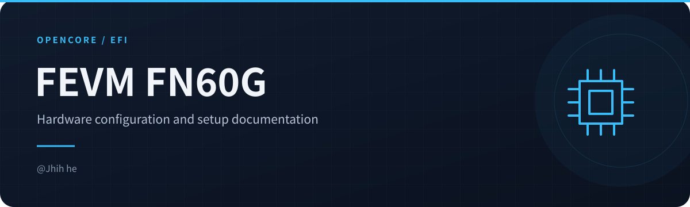

<!-- readme-visuals:header:start -->

  
  
  

<!-- readme-visuals:header:end -->

  
  
  
  

<h1 align="center">FEVM-FN60G Hackintosh EFI for OpenCore</h1>

  <a href="https://github.com/jhihhe/FEVM-FN60G-Hackintosh/blob/main/README.md">中文</a>｜
  <a href="https://github.com/jhihhe/FEVM-FN60G-Hackintosh/blob/main/README-EN.md">English</a>

---

<!-- readme-visuals:overview:start -->

## 项目速览

<table>
<tr>
<td width="33%"><strong>机型配置</strong>  面向 FEVM-FN60G 的 OpenCore 方案。</td>
<td width="33%"><strong>硬件说明</strong>  CPU、显卡、网络与 USB 配置记录。</td>
<td width="33%"><strong>下载与核对</strong>  发行入口、配置提醒及实测状态。</td>
</tr>
</table>

### 流程概览

<!-- readme-visuals:overview:end -->

## 🚀 快速开始
**最新稳定版 EFI 下载** →

> **重要提示**
> 公开包已清空机器信息。使用前请自行生成并填写 `MLB`、`SystemSerialNumber`、`SystemUUID` 和 `ROM`，位置均为 `EFI/OC/config.plist → PlatformInfo → Generic`。保持 `MacPro7,1`，不要照抄别人的四码。
>
> 先备份原 EFI，准备可启动的备用 U 盘，从 U 盘测试后再更新硬盘 EFI。Windows 用户保留自己的 `Microsoft` 目录。

---

## 📜 更新日志
**核心组件升级**

- 这次整理成一份日用配置，6600M 负责输出，不再提供 UHD 770 / WhateverXe 测试配置。
- 无线改用 SimpleBCM 1.2.0；声音用 SimpleHDA 1.0.1 + AppleALC，替代对应的 OCLP 根补丁。
- 机主已确认原日用 EFI 完整回归正常，系统为 macOS 26.7.1（25G313）。
- 公开包清空四码，去掉旧截图、本机日志及无效的 PcmMsrDriver 监控辅助驱动，清理旧 CPU 名称伪装和遗留 OCLP 变量。
- 保留原来可用的 OpenCore MOD（BTWISE）；其内嵌版本字符串不能确认具体版本号。本次没有宣称升级引导核心。

详细内容见 [更新记录](CHANGELOG.md) 和 [组件版本](docs/COMPONENTS.md)。

---

## 📌 项目概述
本项目是 **FEVM-FN60G（i5-13600T + AMD RX 6600M）** 的日用 **OpenCore EFI 配置**，当前实测系统为 **macOS Tahoe 26.7.1**。

- 保留现有 CPU 电源管理配置，机型使用 MacPro7,1。
- 6600M 负责画面输出和显卡加速，沿用 WhateverGreen 和可用的显卡属性。
- SimpleBCM 负责无线，LucyRTL8125Ethernet 负责有线网络。
- SimpleHDA 配合 AppleALC 驱动声音，沿用 `alcid=98`。
- 保留多系统扫描和本机 USB 定制。其他硬件批次需要自行核对，不承诺所有 12–14 代机器通用。

---

## 📥 下载与更新
- **最新版本**：[点击下载](https://github.com/jhihhe/FEVM-FN60G-Hackintosh/releases)
- **更新内容摘要**：
  - 声卡、无线改从 EFI 加载，保留单份 `config.plist`。
  - 保留 6600M 日用方案，去掉核显实验分支。
  - 补齐脱敏模板、迁移与回退说明；旧提交、标签和发行版保留。

---

## ⚙️ 硬件配置
| 组件 | 型号 | 说明 |
|------|------|------|
| **CPU** | Intel® Core™ i5-13600T | 本次实测 CPU，其他型号需自行验证 |
| **显卡** | AMD Radeon RX 6600M | 负责输出和加速；W6600 为注入显示名 |
| **存储** | NVMe SSD | 支持 TRIM，系统运行稳定 |
| **内存** | DDR5 5600MHz | 沿用原硬件记录，按实际内存核对 |
| **有线网卡** | Realtek RTL8125B | 使用 LucyRTL8125Ethernet |
| **无线网卡** | Broadcom（14e4:43a0） | Wi-Fi 使用 SimpleBCM |

---

## 📸 功能实测验证

### 核心功能状态

机主于 2026-11-10 确认原日用 EFI 完整回归正常。下表沿用原来的功能分类，具体测试项目未单独提供记录。

| 功能模块 | 状态 | 说明 |
|---------|------|------|
| CPU 变频 | 日用回归正常 | 保留现有配置 |
| 显卡加速 | 日用回归正常 | 6600M 输出，已检查 Metal 加速 |
| USB | 日用回归正常 | 保留本机 USB 定制 |
| 睡眠唤醒 | 日用回归正常 | 以机主完整回归反馈为准 |
| 有线网络 | 日用回归正常 | RTL8125 |
| 无线网络 | 日用回归正常 | SimpleBCM；连续互通未提供单项测试记录 |
| 声音 | 日用回归正常 | SimpleHDA + AppleALC |

公开包脱敏及辅助驱动清理后已通过静态检查，尚未再次实机启动。旧截图不再展示，避免公开机器信息；[隐私与验证范围](docs/PRIVACY.md) 中有具体说明。

---

## 📝 高级配置
- `ScanPolicy=0` 支持多系统扫描。
- 可按需开启 `-v` 调试；显卡保留 `agdpmod=pikera -wegnoigpu`。
- SIP 沿用日用配置，本次没有提高安全设置。
- 可运行 `python3 tools/verify_efi.py` 检查公开模板；填好四码后加 `--personalized`，只检查结构，不验证 Apple 服务资格。

## 从 OCLP 根补丁迁移

当前声卡和无线方案从 EFI 加载，不需要继续保留对应的 OCLP Wi-Fi / AppleHDA 根补丁。已经正常迁移的机器不用重复操作。

如果系统还装着旧补丁，先备份系统和 EFI，保留原来的 OCLP 版本与恢复网络的办法；用 OCLP 查看实际补丁状态，再撤销旧的声卡、无线根补丁并按其提示重启。OCLP 的撤销可能影响整组根补丁：**还有其他必须依赖的补丁时，先确认其恢复方案**，不要把“撤销全部”当成只卸载声卡网卡。随后切换本 EFI 测试，避免新旧两套方案叠加。

声音沿用 `alcid=98`。显卡保留 WhateverGreen 与 `agdpmod=pikera -wegnoigpu`，不加载 WhateverXe，也不附带 Intel TGL 系统驱动。SIP 沿用原日用配置，没有在本次公开化时提高安全设置；不要把此包理解成默认安全策略。

## 出问题怎么退

从备用 U 盘启动，恢复你自己备份的整份 EFI。若迁移前依赖 OCLP 根补丁，还要用原来的 OCLP 恢复对应系统补丁；仅换回 EFI 不会自动还原系统卷。如果此前装过 WhateverXe 系统驱动，请按其原安装包的卸载说明处理，单独删除 EFI 里的 kext 不等于卸载系统驱动。

---

## 🙏 鸣谢
本项目的实现离不开以下开源项目和技术支持：
- [SimpleBCM](https://github.com/laobamac/SimpleBCM) / [SimpleHDA](https://github.com/laobamac/SimpleHDA) - 当前无线与音频方案
- [OpenCore Legacy Patcher](https://github.com/dortania/OpenCore-Legacy-Patcher) - 博通网卡驱动支持
- [daliansky/FEVM-FN60G-Hackintosh](https://github.com/daliansky/FEVM-FN60G-Hackintosh) - EFI配置参考
- [Xmingbai/FEVM-FN60G-Hackintosh](https://github.com/Xmingbai/FEVM-FN60G-Hackintosh) - 硬件兼容性方案
- [黑果小兵部落阁](https://blog.daliansky.net/) - 安装教程与疑难解答

维护：**@Jhih he**。第一方配置、文档和脚本使用 MIT 许可；第三方驱动和 Apple 组件保留各自条款，详见 [上游与许可](THIRD_PARTY.md)。
